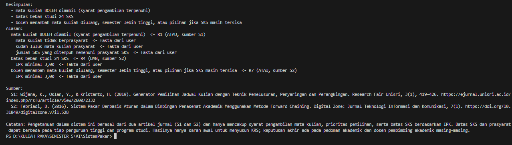
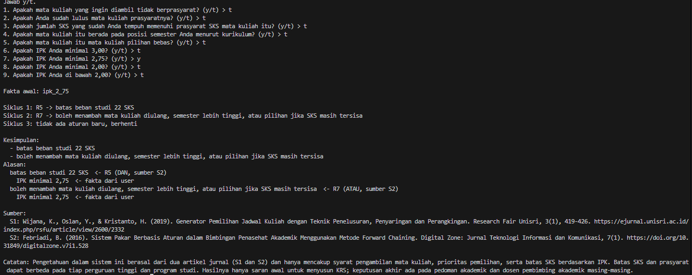
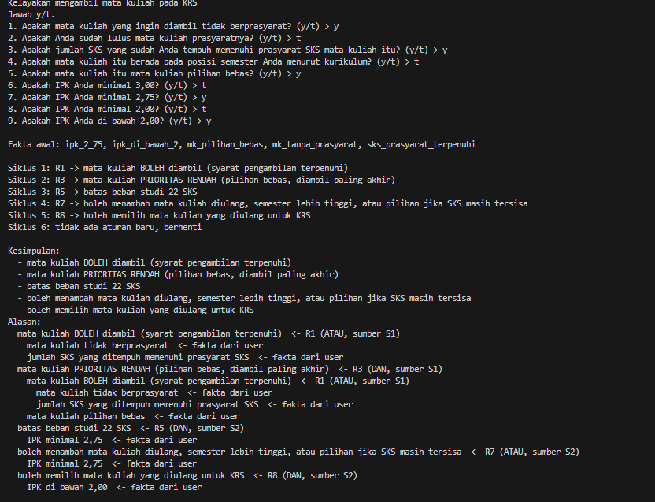

# Sistem Pakar Kelayakan Mengambil Mata Kuliah pada KRS

**Nama:** (M. ARYA RAKA BIMO)  
**NIM:** (F1D02410014)

## 1. Topik dan cara menjalankan

Topik: syarat dan aturan pengambilan mata kuliah (prasyarat mata kuliah, prioritas pemilihan, dan batas SKS berdasarkan IPK) yang dipakai mahasiswa saat menyusun Kartu Rencana Studi (KRS).

- Bahasa pemrograman menggunakan: Python 3.8.
- `sistem_pakar.py`: program (mesin inferensi Forward Chaining).
- `basis_aturan.py`: basis pengetahuan (aturan IF-THEN, label, pertanyaan, sumber). File ini dimuat program lewat `import`.
- Mode tanya-jawab: `python sistem_pakar.py`
- Mode langsung (untuk kasus uji): `python sistem_pakar.py --fakta lulus_mk_prasyarat,ipk_2_75`

## 2. Sumber dan aturan IF-THEN

| Kode | Judul                                                                                                                                    | Penerbit                                                      | URL                                                                | Tanggal akses    |
| ---- | ---------------------------------------------------------------------------------------------------------------------------------------- | ------------------------------------------------------------- | ------------------------------------------------------------------ | ---------------- |
| S1   | Wijana, K., Oslan, Y., & Kristanto, H. (2019). Generator Pemilihan Jadwal Kuliah dengan Teknik Penelusuran, Penyaringan dan Perangkingan | Research Fair Unisri, 3(1), 419-426                           | https://ejurnal.unisri.ac.id/index.php/rsfu/article/view/2600/2332 | 13 November 2026 |
| S2   | Febriadi, B. (2016). Sistem Pakar Berbasis Aturan dalam Bimbingan Penasehat Akademik Menggunakan Metode Forward Chaining                 | Digital Zone: Jurnal Teknologi Informasi dan Komunikasi, 7(1) | https://doi.org/10.31849/digitalzone.v7i1.528                      | 13 November 2026 |

Dasar aturan dari sumber:

- S1: mata kuliah dapat diambil jika tidak berprasyarat, atau prasyarat kelulusan mata kuliah lain sudah dipenuhi, atau prasyarat jumlah SKS sudah dipenuhi. Mata kuliah diurutkan menurut posisi semester dalam kurikulum, dan mata kuliah pilihan bebas diberi prioritas paling rendah.
- S2: batas beban studi mengikuti IPK (IPK minimal 3,00 sebesar 24 SKS, minimal 2,75 sebesar 22 SKS, minimal 2,00 sebesar 20 SKS). Mahasiswa dengan IPK di bawah 2,00 dapat memilih mata kuliah yang diulang, sedangkan mahasiswa dengan IPK minimal 2,00 dapat menambah mata kuliah diulang, semester lebih tinggi, atau pilihan bila SKS masih tersisa.

| Aturan | IF                                                                                     | THEN                                | Sumber |
| ------ | -------------------------------------------------------------------------------------- | ----------------------------------- | ------ |
| R1     | tidak berprasyarat ATAU sudah lulus mata kuliah prasyarat ATAU SKS prasyarat terpenuhi | syarat_mk_terpenuhi (boleh diambil) | S1     |
| R2     | syarat_mk_terpenuhi DAN sesuai posisi semester                                         | prioritas_tinggi                    | S1     |
| R3     | syarat_mk_terpenuhi DAN mata kuliah pilihan bebas                                      | prioritas_rendah                    | S1     |
| R4     | IPK minimal 3,00                                                                       | batas_sks_24                        | S2     |
| R5     | IPK minimal 2,75                                                                       | batas_sks_22                        | S2     |
| R6     | IPK minimal 2,00                                                                       | batas_sks_20                        | S2     |
| R7     | IPK minimal 3,00 ATAU minimal 2,75 ATAU minimal 2,00                                   | boleh_tambah_mk_lain                | S2     |
| R8     | IPK di bawah 2,00                                                                      | boleh_pilih_mengulang               | S2     |

Total ada 8 aturan dan 8 kesimpulan. R2 dan R3 memakai hasil R1 sebagai syaratnya, sehingga terbentuk aturan. Aturan R1 dan R7 memakai mode ATAU, sedangkan aturan lainnya memakai mode DAN.

Karena pengguna yang ber-IPK tinggi akan menjawab "ya" pada beberapa batas IPK sekaligus, R4 sampai R6 bisa menyala bersamaan. Program hanya menampilkan batas SKS yang tertinggi sebagai kesimpulan.

## 3. Metode yang dipilih: Forward Chaining (FC)

Saya memakai Forward Chaining karena data awalnya sudah ada di tangan pengguna, yaitu kondisi mata kuliah yang dituju dan IPK-nya, sedangkan yang ingin diketahui adalah kesimpulan apa saja yang bisa ditarik dari kondisi itu. Alurnya bergerak dari fakta menuju kesimpulan. Metode ini juga dipakai pada sumber S2.

Langkah kerjanya program:

1. Program menanyakan fakta dasar, yaitu fakta yang tidak pernah menjadi hasil aturan. Jawaban "ya" disimpan di memori kerja.
2. Program mencari aturan yang syaratnya terpenuhi oleh isi memori dan hasilnya belum ada di memori. Pada aturan mode DAN semua syarat harus ada di memori, pada mode ATAU satu syarat cukup.
3. Hasil aturan pertama yang cocok ditambahkan ke memori, dan aturan itu dicatat sebagai alasan.
4. Langkah 2 dan 3 diulang. Karena hasil aturan ikut masuk memori, aturan lain bisa menyala setelahnya (misalnya R2 setelah R1). Proses berhenti ketika tidak ada aturan baru yang cocok.
5. Program menampilkan kesimpulan beserta alasannya, yaitu aturan mana yang dipakai dan fakta apa yang mendasarinya. Jika tidak ada kesimpulan yang tercapai, program menyatakannya.

## 4. Kasus uji

| #   | Jawaban "ya"                                                                                | Kesimpulan                                                                     |
| --- | ------------------------------------------------------------------------------------------- | ------------------------------------------------------------------------------ |
| 1   | sudah lulus mata kuliah prasyarat, sesuai posisi semester, IPK minimal 3,00, 2,75, dan 2,00 | boleh diambil, prioritas tinggi, batas 24 SKS, boleh menambah mata kuliah lain |
| 2   | SKS prasyarat terpenuhi, mata kuliah pilihan bebas, IPK minimal 2,75 dan 2,00               | boleh diambil, prioritas rendah, batas 22 SKS, boleh menambah mata kuliah lain |
| 3   | hanya sesuai posisi semester dan mata kuliah pilihan bebas                                  | tidak ada kesimpulan (kasus negatif)                                           |

HASIL 1:

HASIL 2:

HASIL 3:

## 5. Batas keberlakuan

Pengetahuan yang ada dalam menyusun kode ini berasal dari dua artikel jurnal dan hanya mencakup syarat pengambilan mata kuliah, prioritas, serta batas sks berdasarkan IPK. batas sks pada setiap perguruan tinggi berbeda-beda. sehingga angka pada sistem ini tidak bisa dianggap sebagai/berlaku untuk semua kampus.

## 6. Penggunaan alat bantu AI

Pada tugas kali inin saya menggunakan AI Claude untuk membantu saya dalam mecari jurnnal , menyususn aturan dan membantu saya dalam menyususn code.
